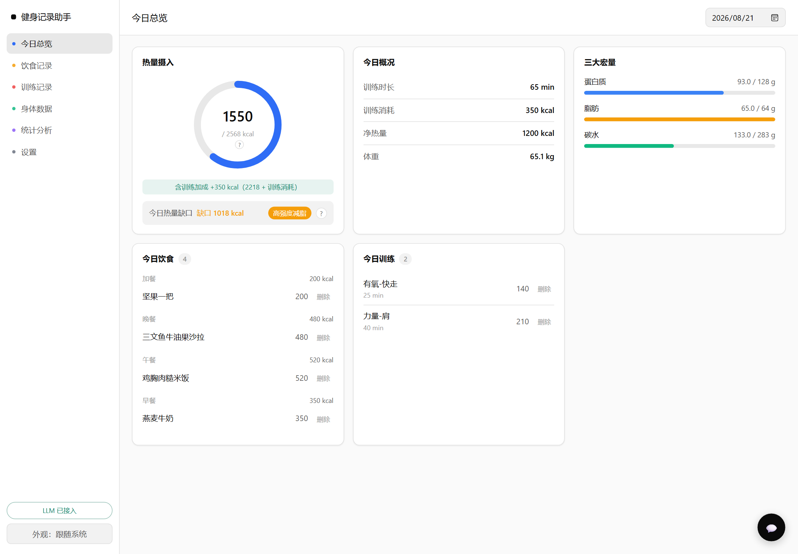

# Simple Fitness Dashboard



本地优先的健身记录助手：记录饮食 / 训练 / 身体数据，由 LLM Agent 驱动自然语言交互，配套 Vue 单页前端做可视化总览与统计分析。

## 功能

- **数据记录**：饮食（餐次、食物、分量、热量、三大宏量）、训练（部位、时长、消耗、备注）、身体（体重、体脂、腰围）。列表支持行内编辑与软删除。
- **LLM Agent**：基于 LangGraph 的对话助手，支持自然语言建档、记录、查询、删除二次确认、页面导航。未配置 LLM 时优雅降级，网页功能不受影响。
- **目标与缺口联动**：按 BMR（Mifflin-St Jeor）→ TDEE（活动系数）→ 每日目标（目标系数）推算；当日训练消耗实时抬升有效目标，缺口口径与热量环自洽。
- **可视化**：热量摄入环、三大宏量进度、今日概况、训练 / 饮食记录、区间统计图表（趋势折线、宏量占比、训练部位分布）。
- **黑白极简 UI**：浅 / 深主题切换，右下角悬浮助手（浮窗不遮挡背后交互）。

## 技术栈

- 后端：FastAPI + SQLite + LangGraph（OpenAI 兼容接口，默认 DeepSeek-V3）
- 前端：Vue 3 + Chart.js（本地 vendor，离线可用，CDN 兜底）
- 架构：API-first，网页仅作客户端；原生 App 可直接复用 `/api`

## 快速开始

```bash
# 1. 安装依赖（建议使用虚拟环境）
pip install -r requirements.txt

# 2. 配置 LLM（可选，不填则 Agent 不可用但网页正常）
cp .env.example .env
# 编辑 .env，填入 OpenAI 兼容接口的密钥：
#   LLM_API_KEY=sk-xxx
#   LLM_BASE_URL=https://api.siliconflow.cn/v1   # 任意 OpenAI 兼容服务均可（SiliconFlow、DeepSeek 官方、本地 vLLM 等）
#   LLM_MODEL=deepseek-ai/DeepSeek-V3

# 3. 启动
python run.py
```

服务监听 `0.0.0.0:8000`。本机访问 `http://127.0.0.1:8000`；同 WiFi 下手机用局域网 IP 访问。

## 手机版（PWA，无需服务器）

`pwa/` 是纯前端本地版：**数据全部存在手机本地**（IndexedDB），不需要任何后端服务，可离线使用。

- **使用**：手机浏览器打开 `https://shunzhe1121.github.io/Simple-Fitness-Dashboard/` → 菜单「添加到主屏幕」→ 像 App 一样全屏使用
- **AI 对话**：在「设置」页填 OpenAI 兼容接口的 API Key（如 SiliconFlow），key 只存本机
- **备份 / 迁移 / 分享**：设置页「导出全部 JSON」得到备份文件，发给别人导入即用同一套数据——无需注册、无需登录、无需服务器
- **离线**：Service Worker 缓存全部资源，断网也能用（AI 对话除外）
- 本地预览：`python -m http.server 8001 --directory pwa` 后访问 `http://127.0.0.1:8001`

桌面 FastAPI 版（AI 能力更强）与手机 PWA 版并存，两边用 JSON 导出/导入互相同步。

## Android APK（独立安装包）

`mobile/` 是 Capacitor 6 工程，把 `pwa/` 打包成原生 Android APK（WebView 壳），数据同样存手机本地。

- **现成安装包**：`apk/健身记录助手-v1.0-debug.apk`（约 3.9MB，debug 签名，可直接安装）
- **安装**：把 APK 传到手机 → 点击安装 → 首次需允许「安装未知来源应用」
- **重新构建**：改完 `pwa/` 后，`mobile/` 目录内 `cap sync` 同步资源再打包（Windows 上有中文路径/沙箱等坑，完整步骤见技能 `capacitor-apk-build`）

## 项目结构

```
app/
  api.py            FastAPI 路由层
  repository.py     数据层（SQLite 读写、汇总计算）
  nutrition.py      营养/目标/缺口计算
  parser.py         识图文本解析（提取宏量）
  agent/            LangGraph Agent（graph.py + tools.py）
  db.py config.py utils.py
static/
  index.html        Vue 3 SPA
  js/app.js         SPA 逻辑
  css/style.css
  vendor/           Vue + Chart.js 本地副本
pwa/                 手机版（纯前端本地存储，无后端）
  index.html         入口
  js/                utils / nutrition / parser / db(IndexedDB) / agent / localapi / app
  manifest.json      PWA 清单（主屏幕图标、全屏）
  sw.js              Service Worker（离线缓存）
  icon-*.png         应用图标
mobile/              Android APK 打包工程（Capacitor 6）
  capacitor.config.json  应用 ID / 名称 / webDir 指向 ../pwa
  android/           原生 Android 工程（Gradle）
  init-mirror.gradle 阿里云镜像加速脚本
apk/                 构建产物（APK 安装包）
run.py              入口
```
