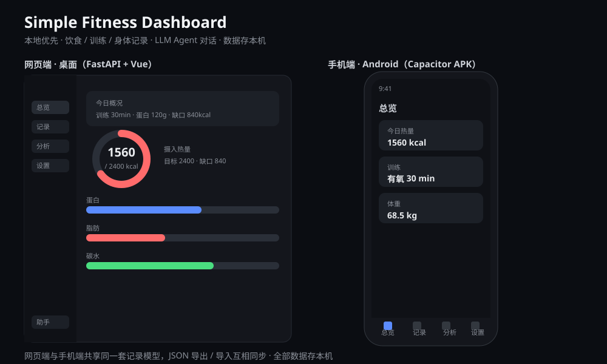

# Simple Fitness Dashboard



本地优先的健身记录助手：记录饮食 / 训练 / 身体数据，由 LLM Agent 驱动自然语言交互，配套 Vue 单页前端做可视化总览与统计分析。**支持两种形态**：桌面网页端（FastAPI 托管）与手机端（Android APK），共享同一套记录模型，用 JSON 导出 / 导入互相同步。

## 功能

- **数据记录**：饮食（餐次、食物、分量、热量、三大宏量）、训练（部位、时长、消耗、备注）、身体（体重、体脂、腰围）。列表支持行内编辑与软删除。
- **LLM Agent**：基于 LangGraph 的对话助手，支持自然语言建档、记录、查询、删除二次确认、页面导航。未配置 LLM 时优雅降级，网页功能不受影响。
- **目标与缺口联动**：按 BMR（Mifflin-St Jeor）→ TDEE（活动系数）→ 每日目标（目标系数）推算；当日训练消耗实时抬升有效目标，缺口口径与热量环自洽。
- **可视化**：热量摄入环、三大宏量进度、今日概况、训练 / 饮食记录、区间统计图表（趋势折线、宏量占比、训练部位分布）。
- **黑白极简 UI**：浅 / 深主题切换；网页端为侧栏布局，手机端为底部导航（总览 / 记录 / 分析 / 设置）；右下角悬浮助手（浮窗不遮挡背后交互）。
- **跨端一致**：网页端与手机端记录结构一致，导出 JSON 在两端都能导入（按「记录类型 + 原 id」去重，不会越导越多）。

## 技术栈

- 后端：FastAPI + SQLite + LangGraph（OpenAI 兼容接口，默认 DeepSeek-V3）
- 前端：Vue 3 + Chart.js（本地 vendor，离线可用，CDN 兜底）
- 架构：API-first，网页仅作客户端；手机 App 是纯前端壳（数据存本机），与桌面版通过 JSON 导出/导入同步

## 快速开始（网页端）

```bash
# 1. 建议先建虚拟环境，避免和系统 Python 依赖冲突
python -m venv .venv
.venv\Scripts\activate            # Windows；Mac/Linux 用 source .venv/bin/activate

# 2. 安装依赖
pip install -r requirements.txt

# 3. 配置 LLM（可选，不填则 Agent 不可用但网页正常）
cp .env.example .env
# 编辑 .env，填入 OpenAI 兼容接口的密钥：
#   LLM_API_KEY=sk-xxx
#   LLM_BASE_URL=https://api.siliconflow.cn/v1   # 任意 OpenAI 兼容服务均可（SiliconFlow、DeepSeek 官方、本地 vLLM 等）
#   LLM_MODEL=deepseek-ai/DeepSeek-V3

# 4. 启动
python run.py
```

服务监听 `0.0.0.0:8000`。本机访问 `http://127.0.0.1:8000`；同 WiFi 下手机用局域网 IP 访问。

> 直接双击 `run.py` 通常会因系统 Python 没装依赖而报错，请务必在装好依赖的虚拟环境（或已装依赖的 Python）里用终端启动。

## 手机版（Android APK）

手机端使用独立安装的 App（数据存手机本地），与网页端并存、互不替代。

- **现成安装包**：`apk/fitness-recorder-v1.0.3-debug.apk`（约 3.9MB，debug 签名，可直接安装）
- **正式分发**：`apk/fitness-recorder-v1.0.3-release.apk`（用 `fitness-recorder-release.jks` 签名，可覆盖升级）。签名密钥库不入库，需自行生成（见下「重新构建」）
- **安装**：把 APK 传到手机 → 点击安装 → 首次需允许「安装未知来源应用」。换过签名后需用 `adb push` + `pm install` 安装（直接 `adb install` 会报 `Failure [-99]`）
- **数据存储**：全部存手机本地（IndexedDB），可离线使用
- **AI 对话**：在「设置」页填 OpenAI 兼容接口的 API Key（如 SiliconFlow），key 只存本机
- **备份 / 迁移 / 分享**：设置页「导出全部 JSON」→ 发给别人导入即用同一套数据；重复导入按「记录类型 + 原 id」自动去重（并集合并），不会越导越多
- **技术说明**：`pwa/` 是纯前端 web 资源（Vue 3 + IndexedDB，零构建），`mobile/` 是 Capacitor 6 工程，把 `pwa/` 打包成原生 Android WebView 壳
- **重新构建**：改完 `pwa/` 后，`mobile/` 目录内 `cap sync` 同步资源再打包（Windows 上有中文路径/沙箱等坑，完整步骤见技能 `capacitor-apk-build`）
- **Release 签名**：首次打包 release 需先生成密钥库（不入库，自行保管）：
  ```bash
  keytool -genkeypair -v -keystore mobile/android/app/fitness-recorder-release.jks \
    -alias fitness-recorder -keyalg RSA -keysize 2048 -validity 10000
  ```
  密码优先读 `~/.gradle/gradle.properties` 的 `FITNESS_RECORDER_RELEASE_STORE_PASSWORD` / `_KEY_PASSWORD`，也可写环境变量；构建用 `gradle assembleRelease`，debug/release 统一用同一 keystore 签名（保证可覆盖升级）
- 本地预览 web 资源：`python -m http.server 8001 --directory pwa` 后访问 `http://127.0.0.1:8001`

## 项目结构

```
app/
  api.py            FastAPI 路由层
  repository.py     数据层（SQLite 读写、汇总计算）
  nutrition.py      营养/目标/缺口计算
  parser.py         识图文本解析（提取宏量）
  agent/            LangGraph Agent（graph.py + tools.py）
  db.py config.py utils.py
static/
  index.html        Vue 3 SPA（网页端界面）
  js/app.js         SPA 逻辑
  css/style.css
  vendor/           Vue + Chart.js 本地副本
pwa/                手机 App 的 web 资源源（纯前端，数据存 IndexedDB，零构建）
  index.html         入口（App 首屏即此页）
  js/                utils / nutrition / parser / db(IndexedDB) / agent / localapi / app
  manifest.json      PWA 清单（APK 壳内使用）
  sw.js              Service Worker（离线缓存，网页部署时生效）
  icon-*.png         应用图标
mobile/              Android APK 打包工程（Capacitor 6）
  capacitor.config.json  应用 ID / 名称 / webDir 指向 ../pwa
  android/           原生 Android 工程（Gradle）
  init-mirror.gradle 阿里云镜像加速脚本
apk/                构建产物（APK 安装包，如 fitness-recorder-v1.0.3-debug.apk / fitness-recorder-v1.0.3-release.apk）
run.py              网页端入口
```
