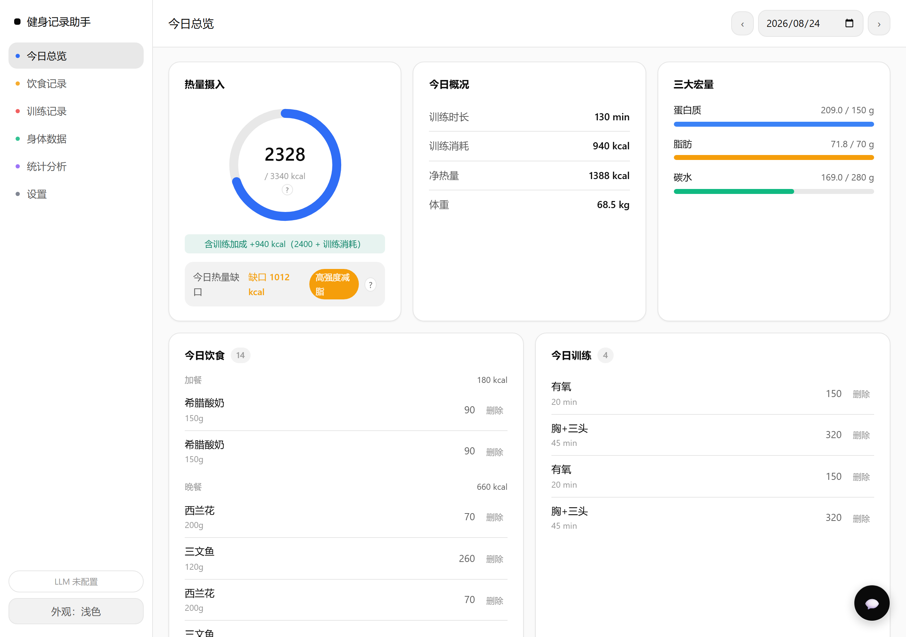
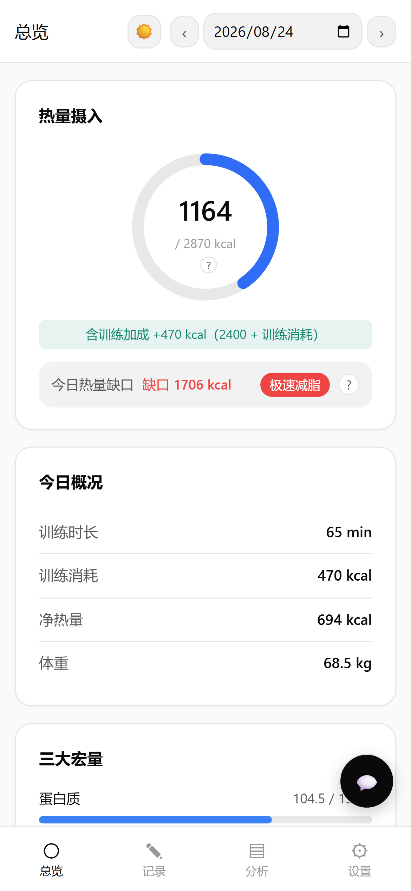
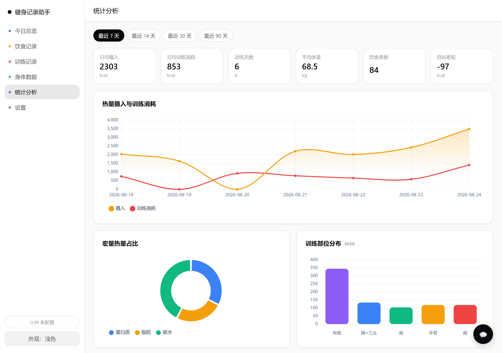
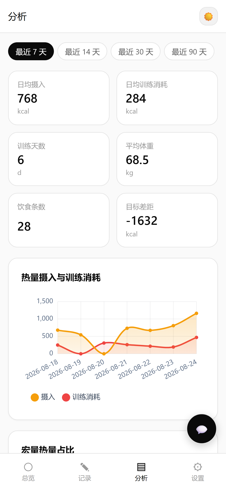

<p align="center"><a href="README-CN.md">简体中文</a> · <b>English</b></p>

# Simple Fitness Recorder: local-first fitness tracker with daily calorie targets and an optional AI assistant

Simple Fitness Recorder is a local-first fitness tracker to help you log diet, workouts, and body measurements, and track your daily calorie target. All data stays on your device; nothing is uploaded to any server.

It ships in two forms — a web app (FastAPI + Vue 3) and an Android app (Capacitor-packed PWA) — sharing the same record model and syncing through JSON export / import.

## Screenshots

#### Desktop · Today's overview



#### Mobile · Today's overview

<p align="center"></p>

#### Desktop · Statistics



#### Mobile · Statistics

<p align="center"></p>

## Installation

### Web app

Requires Python 3.10+.

```bash
git clone git@github.com:shunzhe1121/Simple-Fitness-Dashboard.git
cd Simple-Fitness-Dashboard
python -m venv .venv
source .venv/bin/activate        # Windows: .venv\Scripts\activate
pip install -r requirements.txt
```

### Android app

Install an APK from the `apk/` directory:

- `apk/fitness-recorder-v1.0.3-release.apk` — production-signed, supports in-place upgrade
- `apk/fitness-recorder-v1.0.3-debug.apk` — debug-signed, ~3.9 MB, quick trial

Allow "install from unknown sources" on first install.

## Usage

### Web app

```bash
python run.py
```

Open http://127.0.0.1:8000. On the same Wi-Fi, a phone can reach the server at the LAN address printed on startup.

- Log diet (meal / food / portion / calories / macros), workouts (muscle group / duration / burn), and body measurements (weight / body fat / waist); rows support inline edit and soft delete with trash recovery.
- The daily calorie target is derived from BMR (Mifflin-St Jeor) → TDEE (activity factor) → goal factor; today's workout burn raises the effective target live.
- Paste vision-model OCR output in the template format to parse and store locally, with no LLM cost.
- Optional: set an OpenAI-compatible API key in `.env` to enable the natural-language assistant.

### Android app

Run the app; all data stays on-device (IndexedDB) and works offline. Enable the AI assistant in Settings with an OpenAI-compatible key. Export all JSON in Settings to back up, migrate, or share — re-importing the same file is a no-op, de-duplicated by record type + id.

## Project Structure

```
repo/
├── app/                  FastAPI backend: API routes, SQLite repository, nutrition & parser logic, LangGraph agent
├── static/               Web frontend (Vue 3 + Chart.js, served by FastAPI)
├── pwa/                  Mobile web assets (Vue 3 + IndexedDB, zero build, packed into the APK)
├── mobile/               Capacitor 6 Android project wrapping pwa/
├── apk/                  Built Android APK artifacts
├── assets/screenshots/   README screenshots
├── run.py                Web entry point
└── requirements.txt      Python dependencies
```

| Path | Purpose | Relation |
|---|---|---|
| `app/` | FastAPI backend: routes, SQLite data layer, nutrition, parser, LangGraph agent | Serves `static/`; shares the record model with `pwa/` |
| `static/` | Web frontend (Vue 3) | Client of `app/`'s `/api` endpoints |
| `pwa/` | Mobile web assets (Vue 3 + IndexedDB) | Wrapped by `mobile/`; syncs with `app/` via JSON export/import |
| `mobile/` | Capacitor 6 Android project | Packages `pwa/` into the APKs in `apk/` |
| `apk/` | Built Android APKs | Output of the `mobile/` build |

## Contributing

1. Fork the repository.
2. Create a branch: `git checkout -b feature/xxx`.
3. Make changes and add tests.
4. Run all tests locally and make sure they pass.
5. Open a pull request describing (a) motivation and (b) impact scope.

## License

No license file yet. Contact the author before reuse.

## Contact

Open an issue at https://github.com/shunzhe1121/Simple-Fitness-Dashboard/issues
